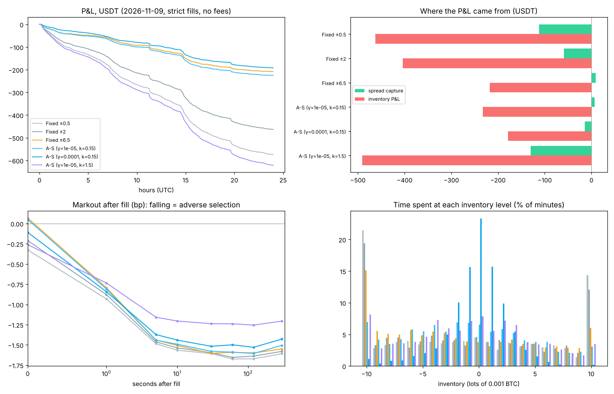
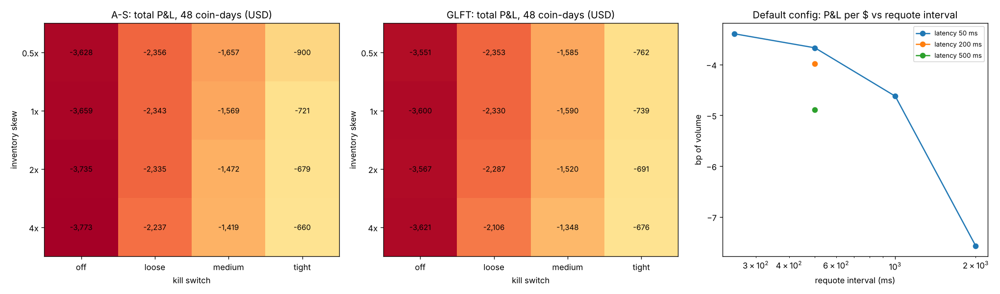
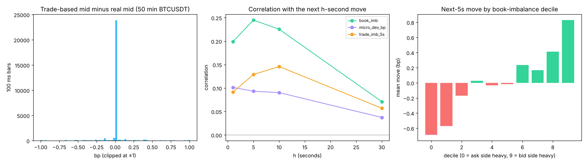
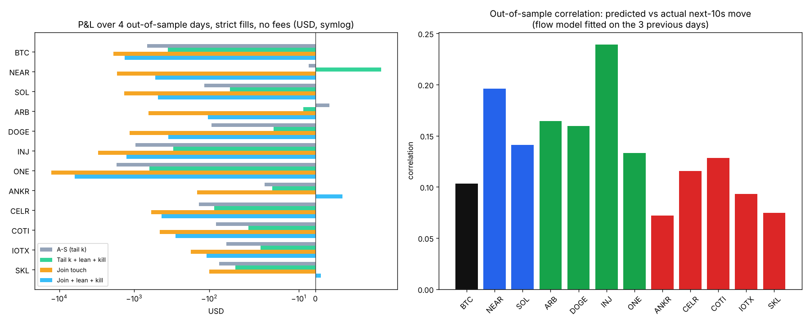
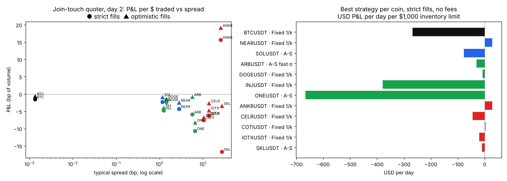
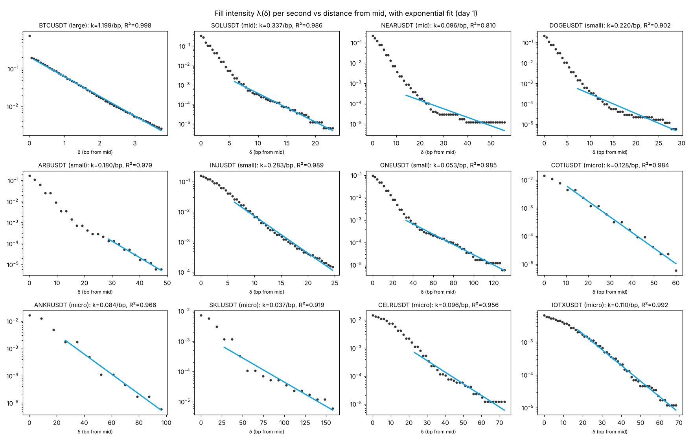
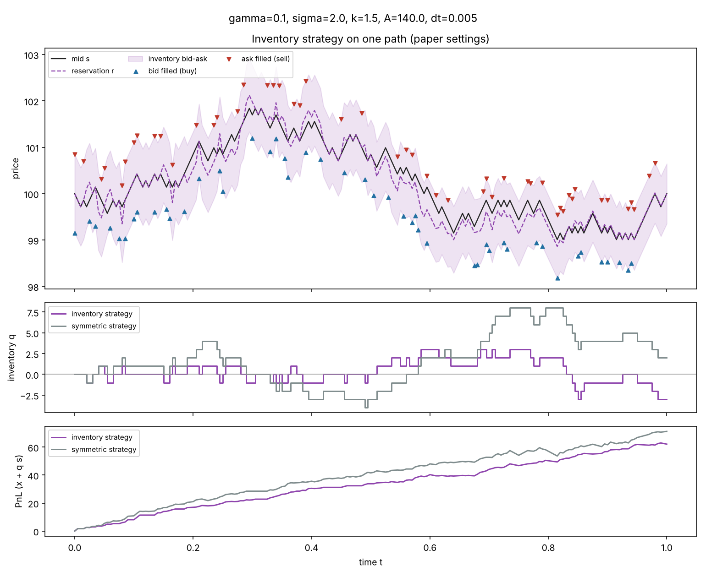
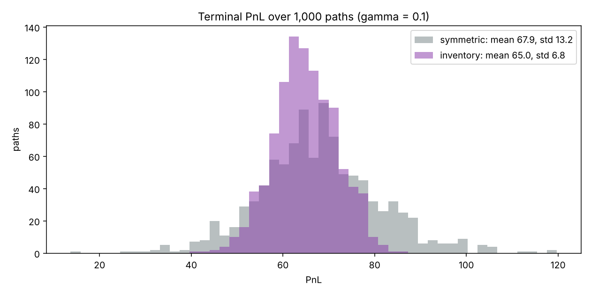

# Avellaneda-Stoikov Market Maker (BTCUSDT)

A from-scratch implementation of the Avellaneda & Stoikov (2008) market-making model: synthetic replication, real-data backtest on Binance, parameter calibration and an interactive HTML dashboard.

**Status:** Day 10 of 14 — quoting core (A-S and GLFT), paper replication, Binance data pipeline, event-driven backtester, per-coin calibration for 12 coins (BTC to micro caps), walk-forward defences against informed traders, a parameter sweep, cross-asset signals and a live order-book study (66 tests). Findings: `notes/week1_review.md`, `notes/day8_small_caps.md`, `notes/day9_informed_flow.md`, `notes/day10_tuning_signals.md`.

## Run it with Docker (no Python needed)

```bash
docker compose up dashboard        # http://localhost:8000/dashboard/index.html
docker compose run --rm tests      # run the test suite
```

Full instructions, including the live order-book recorder: [DOCKER.md](DOCKER.md).

## Setup

```bash
git init as-market-maker && cd as-market-maker   # or unzip this folder
python -m venv .venv
source .venv/bin/activate          # Windows: .venv\Scripts\activate
pip install -r requirements.txt
pytest -q                          # all tests should pass
python -m scripts.plot_quotes      # writes results/day2_quotes.png
python -m scripts.replicate_paper  # day 3-4 figures + results/day4_paper_table.csv
python -m scripts.day4_experiments # study-guide experiments

# Real data (day 5): Binance public archive, no API key
python -m mm.data download --symbol BTCUSDT --date 2026-11-10 --days 2
python -m scripts.explore_day data/BTCUSDT_2026-11-10_trades.parquet
python -m scripts.run_backtest     # day 7: A-S vs fixed spreads on real data (~1 min/day)
python -m scripts.download_universe  # day 8: 9-10 Nov for a range of coins, BTC to micro caps
python -m scripts.run_universe     # day 8: calibrate day 1, backtest day 2 for every coin (~4 min)
python -m scripts.download_universe --date 2026-11-04 --days 5   # day 9: more history
python -m scripts.run_walkforward  # day 9: calibrate on 3 days, test the next; flow model + kill switch (~10 min)
python -m scripts.run_sweep        # day 9: A-S vs GLFT x skew x kill switch, tuned on past days (~20 min)
python -m mm.data download --symbol BTCUSDT --date 2026-11-04 --days 7 --market futures --out data/futures
python -m scripts.run_leadlag      # day 10: BTC spot / perp flow as leading signals (~2 min)
python -m scripts.book_study       # day 10: live order book from the recorder
python -m mm.recorder --symbol BTCUSDT          # live best bid/ask + trades, Ctrl+C to stop
```

## Testnet trading (real orders, fake money)

`mm/testnet.py` runs the same self-calibrating agent as the paper trader, but sends its quotes as
real `LIMIT_MAKER` (post-only) orders to the Binance **spot testnet**. It checks that orders are
placed, replaced, filled, counted and cancelled correctly before any real money is involved.

1. Get keys: https://testnet.binance.vision → log in with GitHub → *Generate HMAC_SHA256 Key*.
2. Copy `.env.example` to `.env` and paste the key and secret (`.env` is git-ignored).
3. Run it: double-click `run_testnet.bat`, or

```bash
python -m mm.testnet --symbols BTCUSDT --dry-run --hours 0.1   # testnet data, orders only logged
python -m mm.testnet --symbols BTCUSDT --policy join            # always quote best bid/ask: plumbing test
python -m mm.testnet --symbols BTCUSDT                          # the agent (quotes only when it sees edge)
docker compose --profile live up testnet                        # same as --policy join, in Docker
```

Guards work on the **real** position: inventory cap (`--q-max` lots of `--lot-usd`), spot balance,
daily loss stop (`--max-loss`), and every open order is cancelled on exit. The agent's simulated
live track is given the real inventory before each decision. Logs: `data/testnet/<SYMBOL>/`
(`orders_*.jsonl`, `fills_*.jsonl`, `status.json`).

**Do not read testnet P&L as a result.** The testnet book is thin and moved by other people's
test bots, so fills and adverse selection look nothing like the real market. Judge the model with
the paper trader (`mm/paper.py`: real data, simulated fills); use testnet to prove the execution
code. Only a few coins exist on testnet (BTC, ETH, BNB and some others), not the micro caps.

## Dashboard

`dashboard/index.html` is an interactive, static dashboard: a live A-S simulator with sliders, model intuition charts, the paper replication, and the real BTCUSDT data analysis. Open the file in a browser (double-click), or host it free on GitHub Pages: Settings → Pages → deploy from the `main` branch, root folder; it is then at `https://<user>.github.io/<repo>/dashboard/`.

The page has two groups of tabs. **Desk** (Overview, P&L, Execution, Risk, ...) is a trading dashboard that reads *run bundles* from `dashboard/runs/` (written by `mm/report.py`; see `docs/DASHBOARD_GUIDE.md`). Until real runs exist it shows a clearly marked demo run: `python -m mm.report` rewrites it. **Research** holds the original nine tabs.

Regenerate its data after new results or downloads:

```bash
python -m scripts.build_dashboard   # writes dashboard/data.js
```

Edit the `SITE` block at the top of the page's script for your name, GitHub and LinkedIn links.

## Layout

```
mm/strategy.py        A-S core: reservation price, spread, quote()
mm/simulator.py       Brownian mid + Poisson fills, inventory vs symmetric (paper s.4)
mm/data.py            Binance aggTrades downloader (checksum-verified), trades -> time bars
mm/recorder.py        live websocket recorder: bookTicker + aggTrade -> parquet
mm/backtest.py        event-driven backtest: bars, latency, conservative fills, fees, P&L attribution
mm/calibrate.py       per-coin tick, spread, sigma, A, k, two-part (core/tail) fill curve, gamma from target skew
mm/flow.py            past-only flow features (imbalance, momentum, vol ratio, sweeps) and the alpha model
mm/protect.py         A-S or GLFT with defences: lean on predicted flow, kill switch; matches mm.strategy.quote
mm/metrics.py         P&L per volume, markouts, adverse selection, Sharpe, drawdown
mm/paper.py           paper trader: live mainnet data, simulated fills, no orders sent
mm/testnet.py         testnet trader: the same agent, real post-only orders on the Binance spot testnet
notes/derivation.md   Day 1 derivation of the model
dashboard/index.html  interactive dashboard (data in dashboard/data.js, built by scripts/build_dashboard.py)
```

## Model

Reservation price `r = s − q·γ·σ²·(T − t)`; total spread `γσ²(T − t) + (2/γ)·ln(1 + γ/k)`; quotes `r ± spread/2`. Full derivation in `notes/derivation.md`.

## First real-data result (Day 7)

On 9–10 Nov 2026 BTCUSDT (1.85M trades), with strict fills, 50 ms latency and no fees, **every strategy lost money**: about −1.5 bp per dollar traded, for fixed spreads and A-S alike. Fills are worth ~0 at the moment of the fill and −1.2 to −1.7 bp ten seconds later: quotes behind the best price are only reached by sweeps that keep going (adverse selection). A-S with γ = 1e-4 still did its job, cutting inventory std from ~7 lots to under 3. Details: `notes/week1_review.md`.



## Tuning and signals (Days 9–10)

A 32-setting sweep over 48 out-of-sample coin-days: the kill switch dominates (losses −3,659 → −660 USD from off to tight), A-S and the infinite-horizon GLFT model end up close, and choosing settings from past days only cuts losses 58% out of sample. Slow quotes get picked off: requoting every 2 s instead of 250 ms more than doubles the loss per dollar traded, and latency matters (measured ~285 ms from a home PC in Vietnam). The BTC perpetual future leads BTC spot (prediction correlation 0.10 → 0.18) and BTC leads altcoins, but better prediction barely moved P&L. Fifty minutes of live order book show the trade-based mid is unbiased but noisy, and that book imbalance predicts the next 5 s twice as well as trade flow. Details: `notes/day10_tuning_signals.md`.




## Informed traders (Day 9, walk-forward)

12 coins × 4 out-of-sample days, everything calibrated on the 3 previous days. Trade imbalance predicts the next 10 seconds on every coin (out-of-sample correlation 0.07–0.24, direction right 58–65% of the time). A kill switch (no quotes during volatility bursts or just after sweeps) plus leaning quotes on the prediction cut losses by 60% and beat the Day-8 calibration on 11 of 12 coins, but mostly by trading less in the worst moments: per-dollar losses improve only 15%, and everything is negative after a 2 bp fee. A better-fitting fill curve made results worse, because A-S counts fills but cannot tell good ones from toxic ones. Details: `notes/day9_informed_flow.md`.



## From BTC to micro caps (Day 8)

Twelve coins, tiers from measured Binance spot volume ($1.2B/day BTC down to $0.1M/day IOTX), calibrated on 9 Nov and backtested out of sample on 10 Nov. The tick size relative to price is the biggest difference: 0.001 bp for BTC, 26–27 bp for ANKR and SKL, which are tick-constrained. Large and mid caps lose to adverse selection like BTC; the only statistically meaningful positive result is on tick-constrained micro caps (ANKR: +16 bp per dollar traded, 60-s markout t = 2.2), where queue position decides the outcome. One day and a few hundred fills: promising, not proven. Advice on what changes for small caps: `notes/day8_small_caps.md`.




## Paper replication (synthetic market, 1,000 paths, same random numbers for both strategies)

| γ | Strategy | Avg spread | Mean PnL | Std PnL | Std final q |
|---|---|---:|---:|---:|---:|
| 0.01 | inventory | 1.35 | 68.4 | 9.1 | 5.3 |
| 0.01 | symmetric | 1.35 | 68.6 | 13.6 | 8.5 |
| 0.1 | inventory | 1.49 | 65.0 | 6.8 | 3.0 |
| 0.1 | symmetric | 1.49 | 67.9 | 13.2 | 8.3 |
| 0.5 | inventory | 2.16 | 48.6 | 5.9 | 2.0 |
| 0.5 | symmetric | 2.16 | 58.2 | 11.4 | 6.9 |

The inventory strategy gives up a little mean profit for roughly half the PnL volatility and far tighter inventory; higher γ pushes further along that trade-off. This is the pattern reported in section 4 of the paper.



